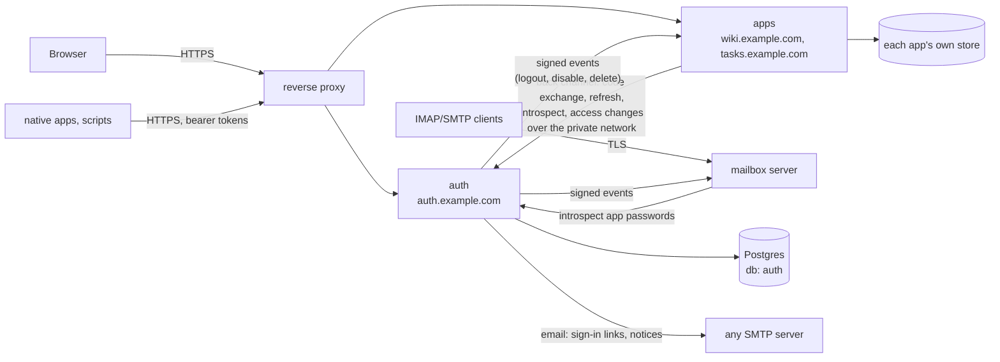
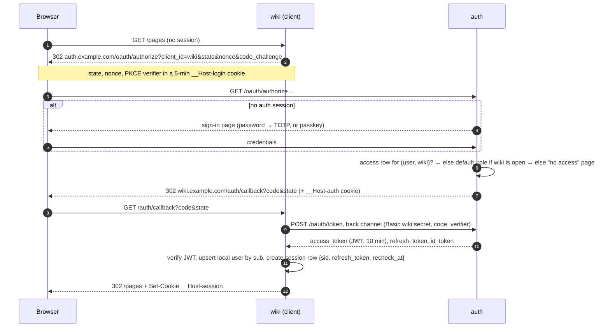

# Auth service: design

Status: proposal. Scope: an identity and access service that anyone can deploy in front of the apps they run. It covers who can sign in, how, and with what access to each app.

## 1. Summary

- **A service, `auth`**: this repo, published as a container image. It runs beside the apps it serves, behind a TLS-terminating proxy, on Postgres in a database of its own. It fits in 128 MB, and two copies can run side by side during a rolling deploy.
- **It owns** people, their credentials (password, TOTP, passkeys, recovery codes, app passwords, API keys), their sign-in sessions, and **which services each person may use, and in what role**.
- **The apps keep** their own data, the resources inside them (a wiki's workspaces and spaces, a tracker's projects, a mail server's mailboxes) with each person's role on each, their own groups, and their own session cookie.
- **Authorization is split in two, as behind most identity providers.** auth decides who may use each service and with which role across it; the app decides what that role allows and who holds which role on each of its resources (§6.1).
- **The protocol is a small part of OpenID Connect**: the authorization code flow with PKCE, nothing more. Each web app is a confidential client that keeps tokens on its server (the "backend for frontend" pattern), so no token ever reaches browser JavaScript.
- **Access tokens are 10-minute JWTs signed with Ed25519.** Apps check them locally against a cached key set, so a request makes no network call to auth.
- **Revocation reaches apps two ways.** Apps pull: a web app refreshes the token every 10 minutes and learns of changes then. Auth also pushes signed events, which close long-lived connections (websockets, SSE streams, IMAP IDLE) within seconds.
- **The access model is deliberately not IAM.** Each user has at most one role on each service, chosen from the roles that service declares. There are no policy documents, ARNs, deny rules, wildcards or conditions. "Can Alice use the wiki?" is one row:
  ```http
  PUT /v1/users/usr_01jd…/access/wiki   {"role": "member"}
  ```
- **Everything particular to one deployment is that deployment's configuration** (§2): its services, hostnames, secrets and limits. Nothing in this repo knows which apps it will serve.

## 2. A product, not a deployment

### 2.1 The principle

auth is a product. Anyone can deploy it anywhere and connect whatever apps they run. Any one deployment, including the maintainer's, is one adaptation of it, configured outside this repository.

- **Nothing in this repo names or assumes a particular deployment**: not in code, defaults, tests, CI, docs, examples or comments. That rules out real hostnames, domains, app names, operators, hosts and resource figures taken from a specific setup. Examples use reserved names: `example.com`, `.test` and `.internal` domains, the services `wiki`, `tasks` and `mailbox`, and the users `alice` and `bob`.
- **A deployment's specifics are configuration.** That covers its services and their roles, clients and redirect URIs (§6), its issuer URL, secrets, prefixes and alert target. They live in the deployment's environment and files, reviewed wherever that deployment keeps its own configuration.
- **Integration goes only through documented interfaces.** These are the OIDC endpoints, the token and event contracts (§7), the management API and the configuration. auth learns about an app only from its registration, never from code written for it.
- **A feature exists because a kind of app needs it**, and it is described as that kind: "a protocol that can only carry a password", not one named server. A default must make sense for any deployment.
- **The apps on the other side follow the same principle.** Each integrating app is a product of its own. It reaches an identity provider through configuration (issuer URL, client id and secret) and works with any OIDC provider, this one included. It never depends on a particular auth deployment, and auth never depends on it.

### 2.2 What apps need

These are the kinds of app the design serves, and what each needs from it:

- **Web apps with their own user table.** Many tables key on the app's local user id. The app keeps its ids and maps them to auth's (§12.2), keeps its own server-side session, and needs to know of revocation.
- **Servers whose username is a routing key.** A mail server that delivers `*@bob.example.com` to `bob`, or a host that serves `bob.example.com`, needs usernames that are DNS-label-safe and never change (§6).
- **Protocols that can only carry a username and a password.** IMAP, SMTP, CalDAV and WebDAV clients can't do a browser redirect, so they need scoped app passwords that the server checks with auth (§12.4).
- **Scripts and agents** calling an app's API need scoped API keys (§12.5).
- **Native apps** need a public client with PKCE, and possibly a platform sign-in such as Sign in with Apple (§12.3).
- **Long-lived connections** (websockets, SSE, IMAP IDLE) stay open long after sign-in, and an app may run several copies, each holding different connections. Revocation has to reach all of them (§7.4).
- **Apps with resources inside them** (workspaces, spaces, projects, the app's own groups) need a role per person per resource. They keep those roles in their own database, next to the resources, and check them in the query that loads a resource. From auth they need who the person is, whether they may use the app at all, a way to find and invite people, and word when someone leaves (§6.1, §12.6).
- **Apps that manage their own members** need to invite people and change roles from inside the app, for that app only (§12.6).
- **The tools that repair auth** (a deploy pipeline, a monitoring path) must keep working while auth is down (§9.6).

## 3. Goals, non-goals, constraints

**Goals**
1. One account per person, one sign-in for every service they have access to.
2. One place to grant or remove access to a service, and to disable a person everywhere at once.
3. Modern credentials: passwords hashed with argon2id, TOTP, passkeys, recovery codes, and scoped app passwords and API keys in place of shared secrets.
4. An app needs no network call to auth to serve a request.
5. Interfaces small enough to read in one sitting. Where a standard exists (OIDC, RFC 7009, 7662, 8417), use it and use none of its optional parts.
6. Deployable anywhere: one container plus Postgres, with everything deployment-specific in configuration (§2).

**Non-goals**
- Authorization inside an app: roles on a workspace or a space, the app's own groups, page permissions, share links, ownership checks, mailbox delegation. These stay in the apps, next to the data they protect (§6.1).
- A policy language, groups shared across services, or organizations and tenants. One deployment serves one set of people; run a second deployment for a second set. An app's own tenants, such as workspaces, are its resources.
- Federation with outside identity providers in v1 (Google, GitHub). Platform sign-in for native apps is designed (§12.3) but not built.
- Authenticating deploy pipelines and the tools that repair auth (§9.6).

**Constraints**
- **128 MB and half a CPU per container**, sized so that a memory-pressure alarm at 85% of the limit stays quiet.
- **Two copies at once during a rolling deploy**, with no shared memory. Schema changes must be expand/contract.
- **Assume an attacker can read the database.** It holds hashes and ciphertext only (§9.3).
- **No Redis, no queue.** Postgres is the only shared state.
- **A container image** is the unit of release.

## 4. Use cases

P0 is needed before the first app integrates, P1 before a typical deployment can move all its apps, P2 after.

**People**

| # | Use case | Pri |
|---|---|---|
| U1 | Sign in once and use every service granted, without signing in again (SSO). | P0 |
| U2 | Sign in with a password plus TOTP. | P0 |
| U3 | Sign in with a passkey, which is phishing-resistant and counts as two factors. | P1 |
| U4 | Sign out of one app, or of everything. | P0 |
| U5 | Accept an invitation: create the account (choosing an immutable username) or attach the grant to an existing one. | P0 |
| U6 | Reset a forgotten password through a verified recovery email, or with a recovery code when that email is unreachable (for example an address hosted by a service you're locked out of). | P0 |
| U7 | Change name and recovery email. The new address is verified and the old one gets a notice. | P0 |
| U8 | Change password; add or remove TOTP and passkeys; regenerate recovery codes. Each needs a sign-in within the last 15 minutes. | P0 / P1 |
| U9 | List signed-in devices and sign any of them out. | P0 |
| U10 | Create and revoke app passwords for clients of password-only protocols, each limited to scopes the service declares (for a mail server, `imap`, `smtp` or both). | P1 |
| U11 | Create and revoke API keys for one service with that service's scopes. | P1 |
| U12 | See which services you can use, and in what role. | P1 |
| U13 | Get an email on a security change: password, MFA, a new app password or key, or a sign-in from a new device. | P1 |
| U14 | Delete your own account, where the deployment allows it (a native app distributed through a store may be required to offer this). | P2 |

**Administrators**

| # | Use case | Pri |
|---|---|---|
| A1 | Invite someone by email to a service with a role, or create a user directly. | P0 |
| A2 | Grant, change or remove a user's access to a service. | P0 |
| A3 | Disable a user. Sessions, tokens, app passwords and keys stop at once, and open connections close within seconds. | P0 |
| A4 | Delete a user. Auth erases them, and every app is told so it can delete or anonymise its own data. | P1 |
| A5 | Send a reset link or clear someone's MFA after verifying them out of band. This is audited and alerted. | P0 |
| A6 | Read the audit log: sign-ins, failures, and every access or credential change. | P1 |
| A7 | Break-glass: from a shell where auth runs, create an admin or clear MFA when the UI is unreachable. | P0 |
| A8 | A service's own admins (a wiki's owners) invite and manage members from inside the app, without being auth-wide admins. | P1 |
| A9 | Bot users: non-person accounts owned by a person, with no interactive sign-in, holding only app passwords and keys. They replace credentials shared between people or between services. | P2 |

**Apps**

| # | Use case | Pri |
|---|---|---|
| S1 | Sign a user in by redirect, never seeing their password. | P0 |
| S2 | Know who the user is and their role on this service, on every request, with no network call. | P0 |
| S3 | Learn of revocation: within 10 minutes by pull, within seconds by push for long-lived connections. | P0 |
| S4 | Check an app password given to a password-only protocol. | P1 |
| S5 | Check an API key presented as `Bearer`. | P1 |
| S6 | Keep the local user row (name, email) in sync. | P0 |
| S7 | Keep serving signed-in users while auth is down or rolling. | P0 |
| S8 | Change access for its own service only, never for others (A8). | P1 |
| S9 | Act as a user of another service (an app that sends mail through a mail server) with a scoped credential of a bot user, not a person's full credentials. | P2 |
| S10 | Find a person to add to one of its resources, among the users who may use the service. | P1 |
| S11 | Invite someone by email to one of its resources, and learn who accepted so it can give them the role there. | P1 |

**Not served by auth**
- **Deploy pipelines and the tools that repair auth** (§9.6).
- **Shared public demo accounts.** An app that wants a demo opens a demo session itself, with no credential. A shared public password on the identity provider could be changed by anyone, could enroll MFA and lock others out, and would hold an SSO session.
- **Third-party credentials an app keeps for its users** (bank links, API tokens of other platforms). They are the app's data.

## 5. Architecture

### 5.1 Components



- **Front channel** (browser ↔ auth): HTML pages for sign-in, sign-up (offered only for a service with `signup: "open"`), account and admin, plus the OIDC `authorize` and `logout` redirects.
- **Back channel** (app ↔ auth): JSON over a private network where the deployment has one, or over HTTPS otherwise. The app authenticates with its client id and secret using HTTP Basic.
- **Event channel** (auth → app): signed JWTs POSTed to each service's event URL. Auth delivers them from a Postgres outbox, retrying for 24 hours.

### 5.2 What is central and what stays in the apps

| Central (auth) | In each app |
|---|---|
| user id, username (immutable), name, recovery email, kind (`person`/`bot`), disabled | the app's local user row: its id, its foreign keys, display data the app needs |
| password, TOTP, passkeys, recovery codes | nothing |
| app passwords, API keys | nothing (the app asks auth to check them, with a 60 s cache) |
| sign-in session (SSO), devices | its own session cookie and row, tied to auth's `sid` |
| **which services a user may use, and the role on each** | what that role allows; the resources inside the app and each person's role on them; the app's own groups; every rule that needs the app's data (§6.1) |
| invitations to a service | the app-specific steps after the first sign-in (adding the user to a default group, creating a mailbox) |
| audit of identity events | audit of app events |

A field moves into auth only when a second service needs it.

### 5.3 Why this shape

- **Apps need no new dependency on auth's availability for ordinary requests.** They verify tokens locally and keep their own sessions. Auth being down stops new sign-ins, not the people already signed in (§9.6).
- **A compromised app can't reach further.** Its client secret gets tokens for its own audience only, finds and changes access for its own service's users only, and can't read auth's database.
- **It is a standard.** Any OIDC library can talk to it, and so can a native app. An app integrated with auth can switch to another OIDC provider, and auth can serve apps written for any provider, without code written for each other.

Rejected shapes (a proxy `auth_request` gateway, a shared cookie on the parent domain, a shared session table, off-the-shelf providers) are in §14.

## 6. Access model

The whole model is three nouns:

- **User.** A person or a bot. `id` is `usr_` followed by 26 base32 characters (a time-ordered UUIDv7). `username` is `[a-z][a-z0-9-]{1,30}[a-z0-9]`, unique and immutable, so a service can use it as a DNS label or an address. Plus `name`, `email` and `disabled_at`.
- **Service.** Something a user can be given access to. It declares its roles in order, its sign-up policy, the roles that require MFA, its scopes, its OAuth clients and its event URL. Services are **the deployment's configuration**: a JSON file auth reads at start (§11), kept wherever that deployment reviews its configuration. Their client secrets live in auth's database.
- **Access.** `(user, service) → role`, at most one row per pair. No row means no access. There is nothing else to evaluate.

A services file, for a deployment with a wiki, a task tracker and a mail server:

```json
{
  "services": [
    {
      "name": "wiki",
      "roles": ["member", "admin", "owner"],
      "mfa_roles": ["admin", "owner"],
      "signup": "invite",
      "manages_own_members": true,
      "clients": [{
        "id": "wiki",
        "type": "confidential",
        "redirect_uris": ["https://wiki.example.com/auth/callback"],
        "post_logout_redirect_uris": ["https://wiki.example.com/"]
      }],
      "events_url": "http://wiki.internal:3000/auth/events"
    },
    {
      "name": "tasks",
      "roles": ["user"],
      "mfa_roles": [],
      "signup": "open",
      "default_role": "user",
      "api_key_scopes": ["tasks:read", "tasks:write"],
      "clients": [
        { "id": "tasks", "type": "confidential", "redirect_uris": ["https://tasks.example.com/auth/callback"] },
        { "id": "tasks-ios", "type": "public", "redirect_uris": ["com.example.tasks:/auth/callback"] }
      ],
      "events_url": "http://tasks.internal:3000/auth/events"
    },
    {
      "name": "mailbox",
      "roles": ["user", "admin"],
      "mfa_roles": ["admin"],
      "signup": "invite",
      "app_password_scopes": ["imap", "smtp"],
      "clients": [{ "id": "mailbox", "type": "confidential", "redirect_uris": ["https://mail.example.com/auth/callback"] }],
      "events_url": "http://mailbox.internal:3000/auth/events"
    }
  ]
}
```

auth adds one service of its own, `auth`, with the single role `admin`: manage users, access and invites for every service, and read the audit log. `auth:admin` always requires MFA.

The fields of a service:

| Field | Required | Meaning |
|---|---|---|
| `name` | yes | `[a-z][a-z0-9-]{0,62}`, unique; `auth` is reserved. It is the token's `aud`. |
| `roles` | yes | One or more distinct role names, lowest first. |
| `mfa_roles` | yes | The roles that require MFA (§9.1), a subset of `roles`. There is no default: every deployment decides, and `[]` is a decision too. |
| `signup` | yes | How people get access without an admin granting it to them one by one. `closed`: they don't. Access comes only from a grant by an `auth:admin`, or by the service's own client when `manages_own_members` is set, and only to existing accounts; no invitations. `invite`: also anyone holding an invitation (§7.5) creates their own account, or uses an existing one, and gets the invited role. `open`: also anyone may create an account on auth's sign-up page or through a platform sign-in (§12.3), and a signed-in user without an access row gets `default_role` when they sign in to the service. So on an open service a role can be changed but not removed: removal answers `409 conflict`, since the next sign-in would grant `default_role` again, and disabling the user (rule 5) is how to keep them out. |
| `default_role` | with `signup: "open"` | The role an open sign-up receives; one of `roles`. |
| `manages_own_members` | no (`false`) | The service's own client may call the ★ endpoints of §7.5 for this service. |
| `api_key_scopes`, `app_password_scopes` | no (none) | The scopes API keys and app passwords for this service may carry. A service with neither gets neither kind of credential. |
| `clients` | yes | One or more, each with an `id` unique across every service, a `type` (`confidential` or `public`), `redirect_uris` and optional `post_logout_redirect_uris`. Redirect URIs are absolute: `https`, `http` only for `localhost`, or a private-use scheme for a public client (RFC 8252). |
| `events_url` | no | Where §7.4's events go. A service without one relies on the pull (§7.1), and on reading its pending invites (§12.6). |

The file is checked at start, like every other setting: a file that breaks any rule above stops the start, and every problem is listed at once.

Rules, in full:
1. **Default deny.** No access row means the app refuses with 403 after sign-in, and auth's page says "you don't have access to wiki". The one exception is a service with `signup: "open"`, which gives a signed-in user without a row its `default_role`.
2. **One role per service**, carried in the token as `"role": "…"`. An app checks `role` against its own short list, for example `if (claims.role !== "admin") return 403`.
3. **A user's power in a service is their role, not scopes.** Scopes exist only on API keys and app passwords, to make them narrower than their owner, never wider: an app authorizes a key or app password by its scopes and its owner's current role together (§12.5).
4. **Only two kinds of caller change access:** an `auth:admin`, for any service, and a service's own client, for that service only, when the service sets `manages_own_members`.
5. **Disabling a user** overrides every access row without deleting it. Re-enabling restores the access they had.

There are no policy documents, `Effect`/`Action`/`Resource`/`Condition`, ARNs, deny statements, wildcard actions, role assumption, permission boundaries or inheritance. If a decision needs data the app owns (whose page is this? who may edit this space?), it is the app's decision (§6.1).

### 6.1 What auth decides, and what the app decides

Authorization happens in two places, as it does behind most identity providers:

| | auth decides | the app decides |
|---|---|---|
| **The question** | May this person use the service at all, and with which role across it? | What does that role allow? May they open this space, edit this page, manage this workspace's groups? |
| **What it holds** | One role per user per service (rules 1–5); the scopes of API keys and app passwords; the roles that require MFA | Its resources (workspaces, spaces, projects); each person's role on each; its own groups and their members; ownership, authorship, share links; which of its own roles need a second factor (§12.6) |
| **Where it lives** | auth's database, and a copy in every token | the app's database, next to the resources |
| **When it applies** | at every sign-in and refresh; disabling and revocation reach every app at once (§7.4) | on every request, in the query that loads the resource |

So the role on a service is authorization, the coarse kind. auth is the gate in front of every app and the one place that removes a person from all of them. The fine kind stays in the app, because:
- **a resource's roles are part of its data.** They are created with it, deleted with it, shown in its share dialog, and read in the same query that loads it: "the spaces Alice can see" is one join.
- **moving them out costs more than it saves.** Checking them in auth puts a network call on every request (against goal 4); keeping a synced copy in each app rebuilds the app's own membership table with a sync protocol in front of it (§14).

The service role still bounds the app's own roles: a person without one can't sign in to the app, so whatever the app's tables say, they reach none of its resources.

## 7. Interfaces

### 7.1 Sign-in, SSO and sign-out



- **The second app:** the `alt` block is skipped, because auth already holds a session. It is two redirects and a back-channel call, about 30–80 ms excluding the user's round trips.
- **Sign out:** the app deletes its session, revokes its refresh token (`POST /oauth/revoke`) and redirects to `auth.example.com/logout?client_id=wiki&post_logout_redirect_uri=…`. Auth ends the SSO session and sends `session.ended` to every client that holds tokens under that `sid`. "Sign out of this app only" skips the redirect.
- **Re-checking access (pull):** when a session's `recheck_at` has passed, the next request refreshes the token over the back channel (about 2 ms) before it is served. The new token carries the current role. `invalid_grant` ends the session. A network error lets the request through and tries again next time, for up to 1 hour of staleness (§9.6).
- **`max_age`:** an app can require a recent sign-in with the standard `max_age` parameter; an admin tool might send `max_age=86400` to ask for a sign-in within the last day.

### 7.2 OAuth and OIDC endpoints

| Endpoint | Notes |
|---|---|
| `GET /.well-known/openid-configuration` | Discovery. Lists only what is below. |
| `GET /.well-known/jwks.json` | Public keys: current, next and previous. `Cache-Control: max-age=3600`. |
| `GET /oauth/authorize` | `response_type=code` only. Required: `client_id`, `redirect_uri` (exact string match against the registered list), `state`, `code_challenge` with `S256`, and `nonce` when `scope` has `openid`. Optional: `prompt=none\|login`, `max_age`, `login_hint`. |
| `POST /oauth/token` | Grants: `authorization_code` and `refresh_token`. Confidential clients use `client_secret_basic`. Public clients use `none` and PKCE. |
| `POST /oauth/revoke` | RFC 7009. Accepts refresh tokens. |
| `POST /oauth/introspect` | RFC 7662, client-authenticated. Checks an **API key or app password**, never a JWT (apps verify those locally). Answers `active: true` only when the credential's service is the caller's, the credential is unexpired and unrevoked, and its owner is enabled and holds a role on that service. Removing someone from a service stops their keys and app passwords for it too. An active answer carries `sub`, `username`, `scope`, and the owner's current `role` on that service. |
| `GET /oauth/userinfo` | OIDC userinfo, for clients that expect it. The client in §7.6 doesn't use it. |
| `GET /logout` | RP-initiated logout. `post_logout_redirect_uri` must be registered for the `client_id`. |

Not implemented, on purpose: implicit and hybrid flows, the password grant, `client_credentials` (service-to-service access uses bot users, §12.7), dynamic registration, consent screens (every client is registered by the deployment), request objects, PAR, DPoP and mTLS.

### 7.3 Tokens and credentials

| Thing | Format | Lifetime | Stored by auth as |
|---|---|---|---|
| Access token | JWT, `{"alg":"EdDSA","typ":"at+jwt","kid":"…"}` | 10 min | not stored |
| ID token | JWT, EdDSA | 10 min; used once, at sign-in | not stored |
| Refresh token, confidential client | `rt_` + 32 random bytes (base64url) | Bound to the SSO session. Not rotated: a confidential client authenticates every use (OAuth 2.1 §4.3.1). | SHA-256 |
| Refresh token, public client | the same | 30 days idle. **Rotated on every use**; reusing one more than 30 s later revokes its whole family. | SHA-256 |
| Authorization code | 32 random bytes | 60 s, single use | SHA-256 |
| SSO session cookie | `__Host-auth` = 32 random bytes | 7 days idle, 30 days absolute | SHA-256 |
| App password | `xxxx-xxxx-xxxx-xxxx`: 16 lowercase base32 characters, 80 bits, easy to type into a phone | until revoked | SHA-256, unique. The password alone identifies its owner. |
| Recovery code | 24 base32 characters in six groups of four (120 bits) | until used | SHA-256, per account |
| API key | `<prefix>_<key id>_<32 random bytes base64url>`. The prefix is the deployment's (`API_KEY_PREFIX`), so it can register the pattern with a secret scanner; the key id is the row's id, which isn't secret and names the key in the UI. | optional expiry | SHA-256, unique. Keys imported from an app's own key table keep their format and are found by hash (§12.5). |
| Reset, verification, invite tokens | 32 random bytes | 30 min / 24 h / 14 days | SHA-256, single use |

Access token claims (all of them):

```json
{
  "iss": "https://auth.example.com",
  "sub": "usr_01jdz5w3k8x2q9v4m7n6p0r1st",
  "aud": "wiki",
  "iat": 1763000000,
  "exp": 1763000600,
  "sid": "ses_01jdz61c0q7h3m2k9x8v5t4w2a",
  "username": "alice",
  "name": "Alice",
  "role": "member"
}
```

- **The ID token adds** `nonce`, `auth_time`, `amr`, `email` and `email_verified`. Email stays out of access tokens, which end up in more logs.
- **`amr` uses RFC 8176's names:** `pwd` for a password, `otp` for a TOTP or recovery code, `swk` and `user` for a passkey (attestation is `none`, so auth doesn't claim the key is hardware-bound), and `mfa` whenever the sign-in used two factors. A password with TOTP gives `["pwd","otp","mfa"]`, and a passkey `["swk","user","mfa"]`. An app that needs a second factor checks for `mfa` alone.
- **Apps verify** `alg` = EdDSA (pinned, never read from the token), `iss`, `aud` = their own client's service, and `exp` with 30 s leeway.

### 7.4 Events to apps (push)

Auth POSTs a Security Event Token (RFC 8417) to the service's `events_url`:

```http
POST /auth/events
Content-Type: application/secevent+jwt

eyJhbGciOiJFZERTQSIsInR5cCI6InNlY2V2ZW50K2p3dCIsImtpZCI6Ii4uLiJ9…
```

```json
{ "iss": "https://auth.example.com", "aud": "wiki", "iat": 1763000000, "jti": "evt_01jdz…",
  "events": { "user.disabled": { "sub": "usr_01jdz5w3…" } } }
```

| Event | Payload | App does |
|---|---|---|
| `session.ended` | `sid` | delete sessions with that `sid`; close their connections |
| `access.changed` | `sub`, `role` (`null` = removed) | update the local role and drop the user's cached introspection answers; on `null`, also delete sessions and close connections |
| `user.disabled` | `sub` | delete sessions, close connections, drop the user's cached introspection answers |
| `invite.accepted` | `invite`, `sub` | give `sub` whatever the app tied to that invitation, such as a role on a space (§12.6) |
| `user.deleted` | `sub` | the above, then delete or anonymise the user's data under the app's own rules |
| `credential.revoked` | `sub`, `id` | drop the app password or key from the introspection cache; a protocol server closes the connections that used it |

- **Answer `2xx` to acknowledge.** Delivery is at least once, so dedupe on `jti`. Auth retries with backoff from 5 s to 1 h, gives up after 24 h, and posts to the deployment's alert webhook if one is configured.
- **An app with several copies receives each event on one of them.** The receiving copy writes to its database, then fans out to the other copies, for example with Postgres `NOTIFY auth_events, '<sub or sid>'`. Each copy `LISTEN`s, closes its own connections and drops its own cached introspection answers.
- **Pull is the safety net.** An event lost for good still takes effect at the next 10-minute recheck, and a lost `invite.accepted` when the app next reads its pending invites (§12.6). Open connections re-check their session row every 60 s.

### 7.5 Management API

JSON under `/v1`. The account and admin pages call the same handlers. Callers are:
- **a signed-in user**, with the `__Host-auth` cookie plus an `X-CSRF-Token` header;
- **an app**, with its client's Basic credentials, which reach only the endpoints and the service marked below.

**Self-service, for the signed-in user**

| Method and path | Purpose |
|---|---|
| `GET` / `PATCH /v1/me` | Profile: `name` and `email` (changing email starts verification) |
| `DELETE /v1/me` | Delete the account, where the deployment allows it (U14) |
| `POST /v1/me/password` | `{current, new}`; ends the user's other sessions |
| `POST` / `DELETE /v1/me/totp` | Enroll (returns an `otpauth://` URI, confirmed with a code) or remove |
| `POST /v1/me/recovery-codes` | Regenerate 10 codes, shown once |
| `GET` / `POST` / `DELETE /v1/me/passkeys[/{id}]` | WebAuthn registration and removal |
| `GET` / `DELETE /v1/me/sessions[/{id}]` | Devices; sign one out |
| `GET` / `POST` / `DELETE /v1/me/app-passwords[/{id}]` | `{name, service: "mailbox", scopes: ["imap","smtp"]}`; the secret is shown once, and listed afterwards by name only |
| `GET` / `POST` / `DELETE /v1/me/api-keys[/{id}]` | `{name, service, scopes, expires_at?}`; the secret is shown once |
| `GET /v1/me/access` | Services and roles |

Changing password, MFA, passkeys, app passwords or keys, and deleting the account, need a sign-in in the last 15 minutes. Otherwise the answer is `403 {"error":"reauth_required"}` and the UI asks for the password or passkey again.

**Administration** (`auth:admin`; the rows marked ★ also accept a service's own client, for its own service only, when it sets `manages_own_members`)

| Method and path | Purpose |
|---|---|
| `GET /v1/users?q=&after=&limit=` ★ | List or search. A service's client sees only the enabled users with a role on its service, each as `{id, username, name, role}`, and its `q` matches the start of a username or name, or a whole email ignoring case, so it can't list addresses. |
| `POST /v1/users` | `{username, name, email, kind?}`, then emails an activation link |
| `GET` / `PATCH` / `DELETE /v1/users/{id}` | `PATCH {disabled: true}` disables |
| `PUT /v1/users/{id}/access/{service}` ★ | `{role}`. Idempotent, so it creates or changes. |
| `DELETE /v1/users/{id}/access/{service}` ★ | Remove access; `409 conflict` on a service with `signup: "open"` (§6) |
| `GET /v1/users/{id}/access` ★ | A service client sees only its own row |
| `DELETE /v1/users/{id}/sessions` | Sign the user out everywhere |
| `POST /v1/users/{id}/reset` | `{send_link: true, clear_mfa: bool}` |
| `POST` / `GET` / `DELETE /v1/invites[/{id}]` ★ | `{email, service, role}`, answering with the invite's `id`; refused for a service with `signup: "closed"`. Accepting gives the invited role, never lowering a role the user already holds, and sends `invite.accepted` (§7.4). `GET` shows `accepted_by` and `accepted_at` once it is accepted. |
| `GET /v1/services` | Services, roles, sign-up policy |
| `GET /v1/audit?user=&after=` | Audit log |

An example of changing a role:

```http
PUT /v1/users/usr_01jdz5w3k8x2q9v4m7n6p0r1st/access/wiki
Authorization: Basic d2lraTouLi4=
Content-Type: application/json

{"role": "admin"}

200 {"service": "wiki", "role": "admin", "granted_by": "cli_wiki", "granted_at": "2026-11-12T16:02:11Z"}
```

### 7.6 What each app implements

Any OIDC client library can do the sign-in. This repo also ships `client/auth-client.ts` for apps on Bun or Node: one file, built-ins only (`node:crypto` for Ed25519), about 300 lines, covering the parts no standard library does (introspection with its cache, events). Apps vendor it at a pinned version.

```ts
const auth = createAuthClient({
  issuer: process.env.AUTH_ISSUER,             // https://auth.example.com
  backChannelUrl: process.env.AUTH_BACKCHANNEL_URL, // optional: a private-network URL for the same service
  clientId: process.env.AUTH_CLIENT_ID,
  clientSecret: process.env.AUTH_CLIENT_SECRET,
  redirectUri: process.env.AUTH_REDIRECT_URI,
});

auth.startLogin(req)            // → { redirectUrl, loginCookie }
auth.finishLogin(req)           // → { claims, idClaims, refreshToken }  (verifies state, nonce, JWT)
auth.refresh(refreshToken)      // → { claims } | throws InvalidGrant | throws Unavailable
auth.verifyAccessToken(jwt)     // → claims   (JWKS cached 1 h; refetched on unknown kid)
auth.introspect(secret)         // → { sub, username, role, scopes } | null   (cached by SHA-256: fresh 60 s, served stale up to 10 min only while auth is unreachable)
auth.revoke(refreshToken)
auth.readEvent(body)            // → { type, sub?, sid?, role?, id?, invite?, jti }  (verifies the SET)
auth.logoutUrl(postLogoutRedirect)
```

**Routes** a web app adds: `GET /auth/login`, `GET /auth/callback`, `POST /auth/logout` and `POST /auth/events`.

**Session row** a web app adds or extends: `auth_sub`, `auth_sid`, `refresh_token`, `role`, `recheck_at`. The refresh token alone is useless: using it needs the client secret, which lives in the app's environment, not in its database.

**Configuration**, all of it the app's own: the issuer URL, an optional back-channel URL, the client id and secret, and the redirect URI. Nothing in the app names a particular auth deployment.

**Cookie:** the app's own cookie is named with the `__Host-` prefix (`__Host-session; Secure; HttpOnly; Path=/; SameSite=Lax`). The prefix stops a sibling subdomain, compromised or served over plain HTTP, from setting it with a parent-domain `Domain` attribute.

### 7.7 Conventions

- **JSON field names are `snake_case`**, as OAuth's are.
- **One error shape everywhere, OAuth's:** `{"error": "<code>", "error_description": "<text>"}`. Codes: `invalid_request` 400, `unauthorized` 401, `forbidden` 403, `reauth_required` 403, `not_found` 404, `method_not_allowed` 405 (with `Allow`), `conflict` 409, `rate_limited` 429 (with `Retry-After`), `invalid_grant` and `invalid_client` 400/401 per RFC 6749, `server_error` 500, `temporarily_unavailable` 503.
- **Lists:** `{"items": […], "next": "<cursor>" | null}`, with `?after=<cursor>&limit=` (at most 100).
- **IDs** are prefixed by type: `usr_`, `ses_`, `apw_`, `key_`, `inv_`, `evt_`. Timestamps are RFC 3339 UTC.
- **Versioning:** the path is `/v1`. Additive changes don't bump it, and clients ignore unknown fields.

## 8. Data model

A database and a role of auth's own. Plain SQL migrations run at boot under `pg_advisory_lock`, each one expand-only, so a copy still running the previous image keeps working while a rolling deploy replaces it.

```sql
CREATE TABLE users (
  id                text PRIMARY KEY,                 -- usr_…
  username          text NOT NULL UNIQUE CHECK (username ~ '^[a-z][a-z0-9-]{1,30}[a-z0-9]$'),
  name              text NOT NULL DEFAULT '',
  email             text,                             -- recovery and notices
  email_verified_at timestamptz,
  kind              text NOT NULL DEFAULT 'person' CHECK (kind IN ('person', 'bot')),
  owner_id          text REFERENCES users,            -- bots only
  password_hash     text,                             -- PHC string; NULL for bots and passkey-only users
  disabled_at       timestamptz,
  created_at        timestamptz NOT NULL DEFAULT now(),
  updated_at        timestamptz NOT NULL DEFAULT now()
);
CREATE UNIQUE INDEX users_email ON users (lower(email)) WHERE email IS NOT NULL;

CREATE TABLE identities (                             -- platform sign-in (§12.3)
  provider   text NOT NULL,                           -- 'apple', …
  subject    text NOT NULL,                           -- the provider's stable user id
  user_id    text NOT NULL REFERENCES users ON DELETE CASCADE,
  created_at timestamptz NOT NULL DEFAULT now(),
  PRIMARY KEY (provider, subject)
);

CREATE TABLE access (
  user_id    text NOT NULL REFERENCES users ON DELETE CASCADE,
  service    text NOT NULL,                           -- checked against the services file (§6)
  role       text NOT NULL,
  granted_by text NOT NULL,                           -- usr_… or cli_<service>
  granted_at timestamptz NOT NULL DEFAULT now(),
  PRIMARY KEY (user_id, service)
);

CREATE TABLE totp (
  user_id        text PRIMARY KEY REFERENCES users ON DELETE CASCADE,
  secret_enc     bytea NOT NULL,                      -- AES-256-GCM, see §9.3
  last_step      bigint NOT NULL DEFAULT 0,           -- blocks replay of a code
  created_at     timestamptz NOT NULL DEFAULT now()
);

CREATE TABLE passkeys (
  id            text PRIMARY KEY,
  user_id       text NOT NULL REFERENCES users ON DELETE CASCADE,
  credential_id bytea NOT NULL UNIQUE,
  public_key    bytea NOT NULL,                       -- COSE
  sign_count    bigint NOT NULL DEFAULT 0,
  name          text NOT NULL,
  created_at    timestamptz NOT NULL DEFAULT now(),
  last_used_at  timestamptz
);

CREATE TABLE recovery_codes (
  user_id   text NOT NULL REFERENCES users ON DELETE CASCADE,
  code_hash bytea NOT NULL,                           -- SHA-256 (§9.1)
  used_at   timestamptz,
  PRIMARY KEY (user_id, code_hash)
);

CREATE TABLE sessions (                               -- SSO sessions at the issuer
  id           text PRIMARY KEY,                      -- ses_…, the token's sid
  user_id      text NOT NULL REFERENCES users ON DELETE CASCADE,
  token_hash   bytea NOT NULL UNIQUE,
  auth_time    timestamptz NOT NULL,                  -- last full sign-in (max_age, 15-min re-auth)
  amr          text[] NOT NULL,
  ip           inet,
  user_agent   text,
  created_at   timestamptz NOT NULL DEFAULT now(),
  last_seen_at timestamptz NOT NULL DEFAULT now(),
  expires_at   timestamptz NOT NULL,                  -- idle
  ends_at      timestamptz NOT NULL                   -- absolute
);

CREATE TABLE refresh_tokens (
  token_hash  bytea PRIMARY KEY,
  family_id   text NOT NULL,                          -- rotation family (public clients)
  session_id  text REFERENCES sessions ON DELETE CASCADE,  -- confidential clients: dies with the SSO session
  user_id     text NOT NULL REFERENCES users ON DELETE CASCADE,
  client_id   text NOT NULL,
  created_at  timestamptz NOT NULL DEFAULT now(),
  expires_at  timestamptz NOT NULL,
  rotated_at  timestamptz,
  revoked_at  timestamptz
);

CREATE TABLE auth_codes (
  code_hash      bytea PRIMARY KEY,
  client_id      text NOT NULL,
  session_id     text NOT NULL REFERENCES sessions ON DELETE CASCADE,
  redirect_uri   text NOT NULL,
  code_challenge text NOT NULL,
  nonce          text,
  expires_at     timestamptz NOT NULL,
  used_at        timestamptz
);

CREATE TABLE credentials (                            -- app passwords and API keys
  id          text PRIMARY KEY,                       -- apw_… / key_…; not secret (§7.3)
  user_id     text NOT NULL REFERENCES users ON DELETE CASCADE,
  kind        text NOT NULL CHECK (kind IN ('app_password', 'api_key')),
  service     text NOT NULL,
  scopes      text[] NOT NULL,
  name        text NOT NULL,
  secret_hash bytea NOT NULL UNIQUE,
  created_at  timestamptz NOT NULL DEFAULT now(),
  last_used_at timestamptz,
  expires_at  timestamptz,
  revoked_at  timestamptz
);

CREATE TABLE client_secrets (                         -- two may be live during a rotation
  client_id   text NOT NULL,
  secret_hash bytea NOT NULL,
  created_at  timestamptz NOT NULL DEFAULT now(),
  revoked_at  timestamptz,
  PRIMARY KEY (client_id, secret_hash)
);

CREATE TABLE invites (
  id          text PRIMARY KEY,                       -- inv_…
  email       text NOT NULL,
  service     text NOT NULL,
  role        text NOT NULL,
  token_hash  bytea NOT NULL UNIQUE,
  invited_by  text NOT NULL,
  expires_at  timestamptz NOT NULL,
  accepted_by text REFERENCES users ON DELETE SET NULL,
  accepted_at timestamptz
);

CREATE TABLE one_time_tokens (                        -- reset, email verification, activation
  token_hash bytea PRIMARY KEY,
  purpose    text NOT NULL CHECK (purpose IN ('reset', 'verify_email', 'activate')),
  user_id    text NOT NULL REFERENCES users ON DELETE CASCADE,
  email      text,
  expires_at timestamptz NOT NULL,
  used_at    timestamptz
);

CREATE TABLE signing_keys (
  kid             text PRIMARY KEY,
  public_jwk      jsonb NOT NULL,
  private_key_enc bytea NOT NULL,
  publish_at      timestamptz NOT NULL,              -- in JWKS from here
  sign_from       timestamptz NOT NULL,              -- publish_at + 1 day
  retire_at       timestamptz                        -- dropped from JWKS
);

CREATE TABLE outbox (                                 -- events to apps
  id              bigserial PRIMARY KEY,
  service         text NOT NULL,
  token           text NOT NULL,                      -- the signed SET
  attempts        int NOT NULL DEFAULT 0,
  next_attempt_at timestamptz NOT NULL DEFAULT now(),
  delivered_at    timestamptz,
  failed_at       timestamptz
);

CREATE TABLE audit (
  id        bigserial PRIMARY KEY,
  at        timestamptz NOT NULL DEFAULT now(),
  actor     text,                                     -- usr_…, cli_<service>, 'host-cli', NULL for anonymous
  action    text NOT NULL,                            -- 'login.ok', 'login.fail', 'access.put', 'mfa.cleared', …
  user_id   text,                                     -- the subject; no FK, so the log outlives a deleted user
  ip        inet,
  detail    jsonb NOT NULL DEFAULT '{}'               -- never a secret, a token or a password
);

CREATE UNLOGGED TABLE throttle (                      -- shared across every copy
  key          text PRIMARY KEY,                      -- 'ip:1.2.3.4:login', 'user:usr_…:login'
  window_start timestamptz NOT NULL,
  hits         int NOT NULL
);
```

**Housekeeping.** An hourly job in one copy at a time, under an advisory lock, does the following:
- drops expired codes, tokens, sessions and `throttle` rows;
- drops delivered `outbox` rows after 7 days;
- drops `audit` rows after the deployment's retention (default 1 year; a deployment under a shorter retention rule sets it lower).

**Size.** For dozens of users the database stays under 10 MB, and audit dominates.

## 9. Security

### 9.1 Credentials

**Passwords**
- **Hashing:** argon2id with m = 19 MiB, t = 2, p = 1 (OWASP's minimum), through `Bun.password`.
  - Measured under Bun 1.4.4: **70 ms to hash, 45 ms to verify** on one core.
  - Bun's default is 64 MiB. Two of those at once would put a 128 MB container at its limit, so set the parameters explicitly and **run at most 2 hashes at a time** (a semaphore). The other requests queue, which caps hashing memory at 38 MiB.
- **Policy** (NIST SP 800-63B): 12–256 characters with no composition rules. Reject passwords found in Have I Been Pwned's k-anonymity range API: only 5 hex characters of the SHA-1 leave the host, and a timeout allows the password. Reject the username and the email as passwords.
- **Unknown users** cost the same as known ones: verify against a dummy hash.

**TOTP**
- RFC 6238 with SHA-1, 6 digits and a 30 s step, accepting ±1 step. A code is refused once `last_step` has passed it.
- Required for `auth:admin` and for every role a service lists in `mfa_roles`, a field every service must set (§6). The UI makes enrolment the next page after such a grant. Until enrolled, the user can't sign in to that service.

**Passkeys (WebAuthn)**
- The RP ID is the issuer's host (`auth.example.com`), not its parent domain. A compromised sibling subdomain can then never ask for an assertion.
- `userVerification: "required"`, so a passkey is two factors by itself and skips TOTP. Attestation is `none`.
- Verification uses `@simplewebauthn/server`. The CBOR and COSE parsing is where hand-rolled code goes wrong. It is the one runtime dependency, with JWTs done with `node:crypto`.

**Recovery codes:** 10 codes of 24 base32 characters (120 bits), shown as six groups of four. NIST SP 800-63B §5.1.2.2 asks for a salted password hash only for look-up secrets under 112 bits, so at this length a code is stored and found like an app password: by its SHA-256, in one indexed lookup scoped to the account. An attempt costs the same whether or not the account exists and however many codes it has left, and it never reaches the hashing semaphore. Each code is usable once; using one is audited and emailed.

**Recovery email**
- Must be verified.
- Changing it emails the old address, and the new one gets a confirmation link.
- A reset link ends all sessions and refresh tokens and needs the second factor if one is enrolled. A user who has lost the second factor uses a recovery code, or an admin clears it (A5).

**App passwords and API keys**
- They have at least 80 bits of entropy, out of reach of offline guessing, so SHA-256 is enough. It also lets the secret alone find its row (§7.3), which a salted hash couldn't, and a check takes microseconds.
- No part of the secret is shown or stored after it is created: a displayed hint would count against its entropy. An app password is listed by its name, an API key by its id, which isn't secret (§7.3).
- Each is limited to one service and the scopes it declares, and is listed with `last_used_at` so it can be revoked.

**Re-authentication:** any change to a credential needs `auth_time` within the last 15 minutes.

### 9.2 Sessions and cookies

**Auth's cookie:** `__Host-auth`, with `Secure; HttpOnly; SameSite=Lax; Path=/`. Its value is random and only the SHA-256 is stored. It lasts 7 days idle and 30 days absolute, and the id is regenerated at every sign-in and step-up.

**CSRF on auth's pages** has three layers:
1. A per-session synchronizer token, in forms and in the `X-CSRF-Token` header.
2. `Origin` must equal the issuer's origin on every non-GET request. A missing `Origin` is refused.
3. `SameSite=Lax`. Sign-in forms get a pre-session CSRF cookie, which blocks login CSRF.

**Headers on every page:**
- `Content-Security-Policy: default-src 'self'; frame-ancestors 'none'; form-action 'self' <registered redirect origins>; base-uri 'none'`
- `Strict-Transport-Security: max-age=63072000`, without `includeSubDomains`, which would bind every sibling subdomain of the issuer
- `Referrer-Policy: no-referrer`
- `Cache-Control: no-store` on anything carrying a token

**Open redirects:**
- `redirect_uri` and `post_logout_redirect_uri` must match a registered value exactly.
- An app's "return to" path stays in its own state cookie and is never a query parameter.

### 9.3 Keys and secrets

- **Token signing:** Ed25519.
  - A new key is generated every 90 days, published in JWKS one day before it signs anything, and kept in JWKS for one day after it stops signing.
  - Apps cache JWKS for an hour and refetch on an unknown `kid`, so a rotation is invisible to them.
  - Rotation runs in whichever copy takes the advisory lock first.
- **Encryption at rest:** private signing keys and TOTP secrets are encrypted with AES-256-GCM.
  - The key is `AUTH_ENCRYPTION_KEY`, 32 bytes, kept in the container's environment and never in the database.
  - Ciphertext starts with a key version (`v1:`), so the key can be rotated.
  - The row id is the GCM additional data, so a ciphertext can't be moved to another row.
- **What a database leak yields:** argon2id hashes, SHA-256 hashes of high-entropy secrets, and ciphertext. Nothing in it can be used to sign in (§3).
- **Database access:**
  - auth's role owns only auth's database, and `CONNECT` on it is revoked from `PUBLIC`.
  - `pg_hba.conf` limits auth's role to the network auth runs on.
  - No app's role can connect to auth's database.
- **Client secrets:** 32 random bytes, SHA-256 stored, two live at once while one is rotated. They are made with the CLI and put into the app's environment.
- **Logging:** the logs never carry a password, code, token, secret, `Authorization` header or cookie. This is enforced by one request logger that prints the method, a route name, the status and the timing, and nothing else (`src/server.ts`).

### 9.4 Abuse controls

Counters live in the `throttle` table, so every copy shares them and a restart doesn't reset them. The client IP is `X-Real-IP`, trusted only from `TRUSTED_PROXIES`, where the proxy sets it from the connecting address. One exception: on `/oauth/introspect`, the authenticated client may name its own end user's address in `X-Real-IP` (a mail server, for its IMAP or SMTP client). Auth uses that only to key the client's introspection-failure counter, never for any other limit, so a client can't choose its key anywhere else.

| Target | Limit |
|---|---|
| Sign-in per account | 5 failures, then one attempt a minute, doubling up to 15 minutes. A successful sign-in or a reset clears it. There is no hard lockout, so nobody can lock another person out. |
| Sign-in per IP | 30 per 15 minutes |
| Second factor per session | 5 attempts, then the sign-in starts over |
| A recovery code outside a sign-in (the U6 reset) | the per-account and per-IP sign-in limits above |
| Reset, invite and sign-up emails | 3 per hour per address, 10 per hour per IP; the answer is the same whether or not the address exists |
| Account creation (sign-up on an open service, or a first platform sign-in) | 10 per hour per IP |
| `/oauth/token` per client | 60 per minute |
| `/oauth/introspect` per client | 600 per minute. Failures are counted per client, and per end-user address the client names (the exception above), so a protocol server's brute-force limits stay effective. |

### 9.5 Threats and mitigations

| Threat | Mitigation |
|---|---|
| Credential stuffing and password spraying | Breached-password check, per-account and per-IP throttling, TOTP and passkeys, MFA required for `auth:admin` and for each service's `mfa_roles`, which every service must set (§6) |
| Phishing | Passkeys bound to the issuer's host; the sign-in UI exists only there |
| A stolen app session cookie | Lasts at most until the SSO session ends; listed in Devices and revocable; `__Host-`, `Secure` and `HttpOnly` |
| A stolen refresh token | Useless without the client secret for confidential clients; rotation and reuse detection for public clients |
| A stolen access token | 10-minute lifetime and audience-bound |
| Authorization code interception or injection | PKCE S256 for every client, single-use 60 s codes, exact `redirect_uri`, `state` and `nonce` |
| Open redirect | Exact-match registered URIs only |
| CSRF and clickjacking | §9.2 |
| Cookie tossing from a sibling subdomain | `__Host-` cookies at auth and in every app |
| A compromised app | It can mint nothing, read nothing of auth's beyond its own service's users, and change access only for its own service. Rotate its client secret. |
| A compromised auth image | Every integrated app falls. So: one runtime dependency, an image a deployment pins by digest (§11), MFA on `auth:admin`, and an alert on every access change for `auth` and on every break-glass use. |
| Database read by a third party | §9.3 |
| An app password sent before TLS on a password-only protocol | The server refuses AUTH before TLS on every port (§12.4) |
| A malicious admin, or a mistake | Audit log, an alert on admin actions, A5 needing an out-of-band check |
| Account takeover through the recovery email | Old-address notice on change, second factor still required after a reset, 30-minute single-use links |

### 9.6 Availability and break-glass

**If auth is down:**
- New sign-ins fail.
- Signed-in users keep working. Apps verify tokens locally and keep their own sessions. When a refresh fails with a network error, the app serves anyway and retries on the next request, for at most 1 hour past `recheck_at`.
- Password-only protocol logins keep working for app passwords checked in the last 10 minutes: the client's cache serves a stale positive answer only while auth is unreachable (§7.6).

**Keep the tools that repair auth outside it.** A deployment's deploy pipeline must not need an auth sign-in, or a broken auth release couldn't deploy its own fix. At least one way into its monitoring and logs must also work without auth, or an auth outage couldn't even be seen.

**Break-glass CLI**, run inside a running auth container by whoever can reach it, so it works whichever copy is up:

```sh
bun cli.ts user create --username alice --email alice@example.com --access auth:admin
bun cli.ts user clear-mfa alice
bun cli.ts client secret wiki        # prints a new secret once
```

Every CLI action is audited as `host-cli` and posted to the alert webhook, if one is configured.

**Backups.** Losing auth's database locks everyone out of every integrated app. Back it up off the host it runs on, encrypted, for example with a nightly `pg_dump` encrypted with `age` to a public key. Restoring it also needs `AUTH_ENCRYPTION_KEY`; keep that offline, separately.

## 10. Performance and resources

| Path | Added latency |
|---|---|
| App request with a valid session (most requests) | **0**: the app's own session lookup |
| App request after `recheck_at` (once per 10 min per session) | about 2–5 ms: one back-channel refresh, one indexed read, no write |
| API request with a JWT | about 60 µs: Ed25519 verify (measured, Bun 1.4.4) |
| API key or app password | about 2–3 ms on a cache miss (introspection), 0 on a hit; 60 s cache |
| Password sign-in | 45–90 ms of argon2id, on purpose, plus page loads |
| SSO into a second app | two redirects and one back-channel call, about 30–80 ms on the server side |

**Resources**
- **Memory and CPU:** designed for a 128 MB limit and half a CPU. Bun's resting RSS is typically 40–60 MB, plus at most 38 MiB of argon2id. That is near an 85% alarm line (109 MB). A deployment that expects bursts of sign-ins should measure its peak and raise the limit if needed.
- **Database load** is dominated by refreshes, one per active session per 10 minutes. At 50 active sessions that is about 0.1 queries per second. The pool is 5 connections.
- **The apps** gain a small client and a JWKS of a few hundred bytes. They lose their password hashing, so peak memory falls.

## 11. Deployment

`docs/DEPLOYMENT.md` is the guide. What the design asks of every deployment:

- **Image.** CD publishes it from `main` once CI passes. A deployment runs it **pinned by digest**, never `latest`, so a release reaches it only through a change it reviews, and a push to this repo can't reach any deployment on its own.
- **Runtime.**
  - One container behind a TLS-terminating proxy that sets `X-Real-IP` from the connecting address. No ports published on the host.
  - 128 MB and half a CPU (§10).
  - Two copies may run side by side during a deploy, so every piece of state lives in Postgres (§8).
  - A `HEALTHCHECK` on `/healthz`. SIGTERM finishes requests in flight and exits.
- **Configuration**, all of it the deployment's own: the issuer URL, the services file (§6), `DATABASE_URL`, `AUTH_ENCRYPTION_KEY`, the API key prefix, the trusted proxies, the SMTP server for its emails, the audit retention (default 1 year), whether people may delete their own accounts (U14; default no), and an optional alert webhook. Secrets come from the environment, never from the image or the database (§9.3).
- **No app depends on auth to start.** Apps fetch keys lazily and keep serving signed-in users while auth is down (§9.6).
- **Database.** Postgres 16: a database and a role of auth's own, the database owned by that role, `CONNECT` revoked from `PUBLIC`, and `pg_hba.conf` allowing the role only from the network auth runs on. No app's role can connect to it.
- **Break-glass CLI.** Runs inside a running container (§9.6).
- **Backups.** Encrypted and off the host (§9.6).

## 12. Integrating an app

Each section covers a kind of app (§2.2). An app integrating with auth keeps its own sign-in behind a flag until its cutover is verified (§13), so a cutover is undone by turning off one flag.

### 12.1 A web app

- Use the routes, session row, configuration and cookie of §7.6.
- Map the token's `role` to what the app allows. Refuse with 403 when there is no role.
- Re-check access at `recheck_at` (§7.1), and handle events (§7.4).
- **Long-lived connections** (websockets, SSE): store `sid` on each connection. On `session.ended`, `user.disabled` and `access.changed`, close the matching connections, on every copy of the app (§7.4). Re-check each connection's session row every 60 s.

### 12.2 An app with its own user table

- **Keep the app's user ids.** Add `auth_sub text UNIQUE` to its users table.
- **Link existing users** with a reviewed mapping, for example a CSV of `local_username,auth_username` that a one-off script writes into `auth_sub`. Accounts that match by verified email can be linked the same way, once someone has checked the list.
- **Create new users on their first sign-in** from the token's `sub`, `username` and `name`, and the ID token's `email`. This is where the app does its own setup, such as adding the user to a default group or creating a mailbox named after the immutable `username`.
- **Copy `name` and `email`** from the ID token at every sign-in and refresh, so the app's own joins keep working.
- **After the cutover,** remove the local password columns and sign-in code in a later release.

### 12.3 A native app

- **Sign-in through the system browser:** a public client, the authorization code flow with PKCE, and a claimed redirect URI (RFC 8252). The app stores the refresh token in the platform's secure storage, and refreshes when a call answers 401, rather than signing the user out.
- **Platform sign-in (designed, not built):** for an app that signs in with the platform's own account system, such as Sign in with Apple, the app sends the platform's identity token to `POST /oauth/token` with `grant_type=urn:ietf:params:oauth:grant-type:token-exchange` (RFC 8693).
  1. Auth verifies the token with the platform (`iss`, `aud`, `exp`, the platform's JWKS and nonce).
  2. Auth finds the user through `identities (provider, subject)`. A new user is created only when the client's service has `signup: "open"`, with a generated username (`u-` followed by 12 base32 characters, immutable like any other) and the service's `default_role`; otherwise the exchange answers `invalid_request`, as RFC 8693 §2.2.2 prescribes for a request refused by policy.
  3. Auth returns a 10-minute access token and a rotating refresh token.
  4. The platform's server-to-server notifications (consent revoked, account deleted) go to auth, which ends the user's sessions or emits `user.deleted`.
  
  A user who signs in only this way may have no email and no password. Their row holds just what the platform sends.
- **In-app account deletion,** where a store requires it, calls `DELETE /v1/me` (U14).

### 12.4 A server for a password-only protocol

For IMAP, SMTP, CalDAV, WebDAV and the like:
- **Check the password with `auth.introspect(password)`.** The app password identifies its user by itself. The server then checks that this user matches the username the client sent, and that the credential's scopes cover the protocol (the service declares them, for example `imap` and `smtp`).
- **Cache positive results** with the client's cache (§7.6). Pass the protocol client's address as `X-Real-IP`, which auth uses only for its introspection-failure counter (§9.4).
- **On `credential.revoked`, `user.disabled` or `access.changed`,** close the user's connections on every copy of the server.
- **Don't accept the account password** on these protocols once the user has MFA, or the protocol becomes a way around it. During a migration, the server can keep accepting its old local passwords until a cutover date, and tell users to create app passwords.
- **Prerequisite:** the server refuses AUTH before TLS on every port, because an app password is a full credential for the protocol.

### 12.5 API keys for an app's API

- **The app checks a `Bearer` key with `auth.introspect`**, and gets back its owner, the owner's current role on the service, and the key's scopes. It authorizes the request by both: a scope grants only what the role also allows, so a key loses power when its owner is moved to a lower role (rule 3). The service declares its scopes in the services file.
- **An app with its own key table can move it into auth:** copy each key's hash, scopes, expiry and revocation into `credentials`, with its owner mapped through `auth_sub`. When the old hashes are SHA-256 of the full key, introspection finds them by hash, so **existing keys keep working without reissue**.

### 12.6 An app with resources inside it, and its own members

- **Its resources, and every role on them, are its own tables,** keyed by auth's `sub`, which is stable and never reused (§6.1). A space's members, for example:
  ```sql
  CREATE TABLE space_members (
    space_id bigint NOT NULL REFERENCES spaces ON DELETE CASCADE,
    user_sub text   NOT NULL,                       -- auth's usr_…
    role     text   NOT NULL CHECK (role IN ('reader', 'writer', 'admin')),
    PRIMARY KEY (space_id, user_sub)
  );
  ```
  Workspaces take the same shape. The app's own groups are two more tables (a group, and its members), and a role row then names a user or a group. Checks join these in the query that loads the resource.
- **Set `manages_own_members`** on the service (§6). The app's client may then call the ★ endpoints of §7.5 for its own service only.
- **Finding people:** a share dialog searches with `GET /v1/users?q=`, which shows the app only the enabled users with a role on its service.
- **Inviting people who can't use the app yet:** the app calls `POST /v1/invites {email, service, role}` and keeps the invite's `id` next to what the invitation is for, such as a role on a space. Auth sends the email; the invitee creates an account or signs in, gets the role on the service, and lands back in the app. Auth then sends `invite.accepted {invite, sub}` (§7.4), and the app gives `sub` the role on the space. An app that misses the event (it has no `events_url`, or delivery gave up) finds the acceptance by reading its pending invites: `GET /v1/invites/{id}` shows `accepted_by`.
- **On a `closed` service** there are no invitations, and search finds only people who already have a role, so adding someone new takes an `auth:admin`.
- **Roles on the service:** the app changes or removes them with `PUT` / `DELETE /v1/users/{id}/access/{service}`, after applying its own rules first (for example, the last owner can't be removed). On a service with `signup: "open"` a role can be changed but not removed (`409 conflict`, §6). The app can still take away any of its own resource roles; keeping someone out of an open service entirely means disabling them, which takes an `auth:admin`.
- **MFA for the app's own powerful roles.** auth requires MFA only for the roles in the service's `mfa_roles` (§9.1). An app whose own roles carry power, such as a workspace owner, either gives them only to people whose service role is in `mfa_roles`, or keeps the ID token's `amr` in its session at sign-in and refuses those roles' actions to a session whose `amr` lacks `mfa` (§7.3). Before a sensitive action it can also ask for a recent sign-in with `max_age` (§7.1).
- **When someone leaves:** losing their role on the service, or being disabled, ends their sessions and stops their API keys and app passwords for it (§7.2), so they reach no resource. The app may keep their resource roles, which apply again if the service role comes back. On `user.deleted` it deletes them.

### 12.7 One service acting as a user of another

An app that sends mail through a mail server, or a job that writes to another app's API, signs in as a **bot user** (A9), owned by a person. It holds an app password or API key scoped to exactly what it does, such as `smtp` only. It never uses a person's credentials, and the credential is revoked on its own.

### 12.8 What stays outside auth

- The deployment's deploy pipeline, and at least one way into its monitoring (§9.6).
- Public demo sessions, which the app opens itself (§4).
- Third-party credentials the app keeps for its users (§4).

## 13. Rollout

**Building auth**

| Phase | What | Done when |
|---|---|---|
| 1 | MVP: users, passwords, TOTP, recovery codes, sessions, OIDC code+PKCE, refresh, JWKS, the services file, access, invites, events, audit, CLI, minimal account and admin pages | An OIDC test client completes sign-in, refresh, revocation and logout; the OpenID Foundation's Basic OP tests pass; the memory peak is measured |
| 2 | App passwords and introspection; API keys; `client/auth-client.ts` | A password-only protocol server and an API client work end to end against a test deployment |
| 3 | Passkeys; bot users; self-service account deletion | |
| 4 | Platform sign-in through token exchange (§12.3) | |

**Adopting auth in a deployment**, in an order that keeps every step reversible:
1. **Prerequisites in the apps:** every session cookie `Secure`, and every password-only protocol server refusing AUTH before TLS.
2. **Deploy auth with no apps,** and sign in as the first admin, with TOTP.
3. **A low-risk internal tool first**, then the web apps one at a time, each behind its flag (§12). Check each one: disabling a user gives 403 within 10 s through an event, and within 10 minutes with events off.
4. **Password-only protocols:** users create app passwords, and then a cutover date turns off the old local passwords.
5. **Clean up:** remove local sign-in code, password columns and flags, one release after nothing has used the fallbacks (audit `login.local` = 0).

**Moving existing users.** For a handful of people, create their accounts with the CLI and let auth email each one an activation link (set a password, enroll TOTP). That is simpler and safer than importing hashes. For more users, import their existing password hashes as a one-off: `Bun.password.verify` reads argon2id and bcrypt PHC strings and re-hashes to argon2id at the first sign-in. Note that bcrypt reads only the first 72 bytes of a password, and some apps truncate before hashing; an import has to verify the way the source app hashed.

## 14. Alternatives considered

| Option | Why not |
|---|---|
| **Forward auth**: the proxy calls auth (`auth_request`) on every request, with a shared cookie on the parent domain | Adds a hop to every request of every app (SSE and assets included), so an auth outage takes down every app. The parent-domain cookie goes to every subdomain, including any served over plain HTTP. It can't serve password-only protocols, native apps or API keys, and it puts auth logic in the proxy's config. It suits only plain web apps behind that proxy. |
| **A shared session table** that every app reads | Every app's database role gets read access to auth's schema, and every schema change in auth becomes a change to every app. |
| **Opaque access tokens with introspection on every request** | A network hop per request; low latency rules it out. Kept only for API keys and app passwords, cached. |
| **Keycloak, Authentik** | Typically several hundred MB of memory, against a 128 MB target; admin models far larger than needed. |
| **Zitadel** | An organizations/projects/grants model, which is the IAM-style complexity this design avoids; heavier than the target. |
| **Ory Kratos + Hydra** | Two services plus a UI to build; more moving parts than the whole of §7. |
| **Authelia** | Light and good at forward auth, but users live in a file or LDAP with no management API, and it has nothing for app passwords on password-only protocols. |
| **Pocket ID** | Passkey-only: password-only protocol clients can't use it. |
| **Kanidm** | Strong, but its integration surface (LDAP, RADIUS) suits a fleet, and password-only protocol servers would need an LDAP bind path. |
| **Central fine-grained authorization**: a policy engine (OPA, Cedar) or a Zanzibar-style store (SpiceDB, OpenFGA) holding every app's resource roles | Each check becomes a network call (against goal 4), or each app keeps a synced copy, which is its own membership table with a sync protocol in front of it. Either way the roles leave the data they describe, and "the spaces Alice can see" stops being one query. It pays off when many apps share the same resources; here each app's resources are its own (§6.1). |

**The cost of building it** is owning security-critical code. That is contained by:
- the narrow scope (§7.2's "not implemented" list);
- one runtime dependency, for WebAuthn;
- standard formats, so off-the-shelf conformance tests apply (the OpenID Foundation's Basic OP test plan);
- review on every change (`docs/agents/auth-reviewer.md`).

## 15. Open questions

1. **Services at runtime:** the services file needs a restart to change. Is that enough, or do deployments need to register services through the management API?
2. **Federation with outside identity providers** (sign in with an existing OIDC provider) is a non-goal for v1. What would make it a goal?
3. **Groups shared across services** (a group such as "Support" that several apps give roles to) are a non-goal; an app's own groups are its own (§12.6). What signal would show that shared groups are needed: the same people granted the same roles in several apps, again and again?
